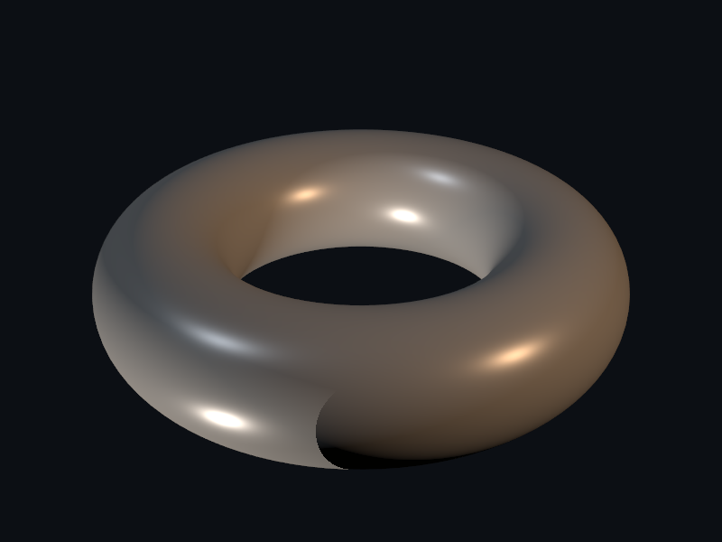
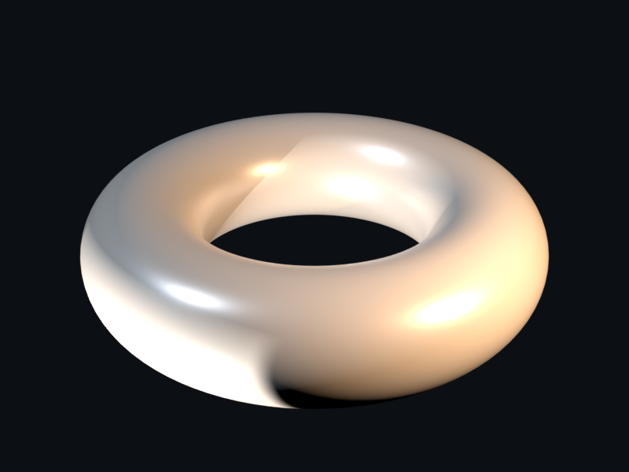
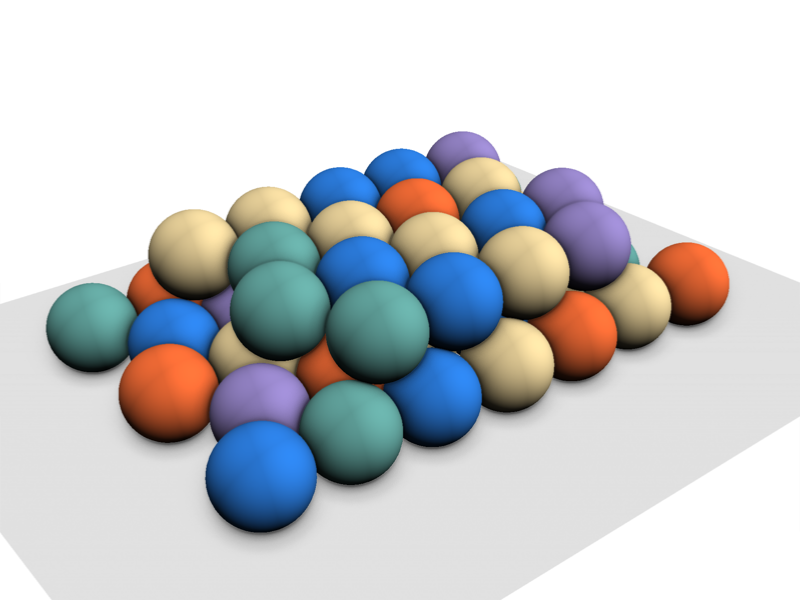
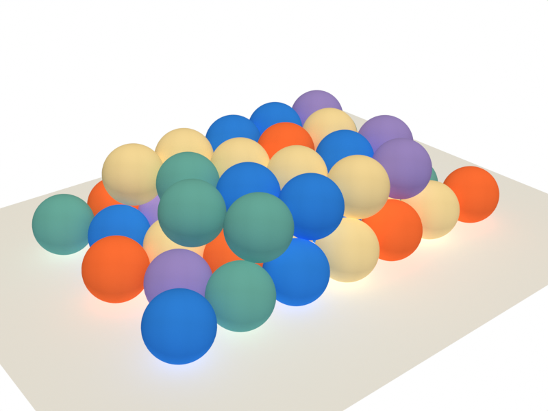
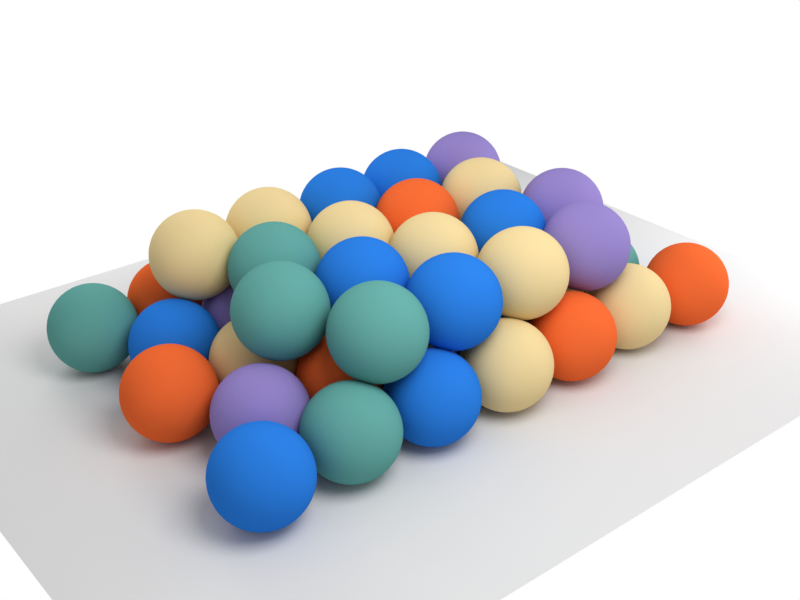

# Lights

Replace the default light kit with a custom rig that exercises every
branch of `translate/light.py`.

## `custom_lights.py`

A custom SUN + POINT + SPOT setup. Energy scaling, color, and
positioning are all set explicitly rather than inherited from the
default plotter kit.

| PyVista                                                                       | Blender (Cycles)                                                              |
| ----------------------------------------------------------------------------- | ----------------------------------------------------------------------------- |
|  |  |

[`examples/lights/custom_lights.py`](https://github.com/kmarchais/pyvista-blender/blob/main/examples/lights/custom_lights.py)
, recipe: [Lights](../cookbook/lights.md).

## `studio_lighting.py`

A heap of spheres on a plane under the default studio rig, against the
translated VTK light kit, with the PyVista preview lit by
`pl.blender.add_studio_lights()`.

| PyVista                                                                  | Blender, VTK light kit                                                 | Blender, studio                                                          |
| ------------------------------------------------------------------------ | ---------------------------------------------------------------------- | ------------------------------------------------------------------------ |
|  |  |  |

[`examples/lights/studio_lighting.py`](https://github.com/kmarchais/pyvista-blender/blob/main/examples/lights/studio_lighting.py)
, recipe: [Lights](../cookbook/lights.md).
